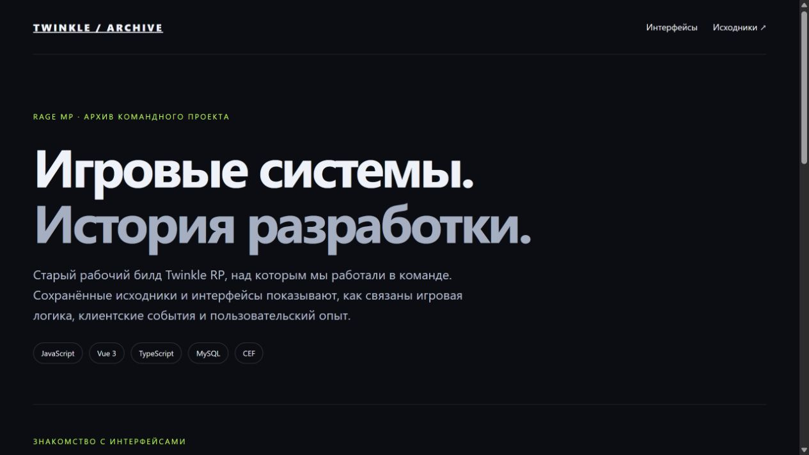

# Twinkle RP · Архив разработки



Ознакомительный архив командного проекта для **RAGE MP**: игровые системы, клиентская логика и интерфейсы.

[Открыть демо](https://xtrasupra.github.io/twinkle-rp-archive/) · [Исходный код](https://github.com/xtrasupra/twinkle-rp-archive)

## О проекте

Старый рабочий билд для **RAGE MP**, над которым мы работали в команде. Этот архив сохраняет важные системы и взаимодействие серверного JavaScript, клиентских событий RAGE MP и CEF-интерфейсов на Vue. Он предназначен для знакомства с устройством проекта и опытом разработки.

## Основные системы

| Область | Модули в `packages/twinkle/` | Что можно изучить |
|---|---|---|
| Аккаунт и персонаж | `auth, characters, systems/character` | Авторизация, регистрация, выбор персонажа и спавна. |
| Транспорт | `systems/vehicle, systems/vehicleDealership, systems/rentcar, systems/lsc` | Состояние и владение транспортом, автосалон, аренда и тюнинг. |
| Имущество и экономика | `systems/house, systems/condos, systems/business` | Дома, квартиры, бизнесы и связанные сценарии взаимодействия. |
| Инвентарь и документы | `systems/inventory, systems/documents, systems/licenses` | Предметы, использование документов и лицензии. |
| Работы и активности | `systems/jobs, systems/fishing, systems/hunting, systems/quests` | Игровые работы, рыбалка, охота и задания. |
| Фракции и администрация | `systems/fractions, systems/governmentComputer, systems/admin, systems/adminBridge` | Фракционные интерфейсы, государственный компьютер и инструменты модерации. |
| Интерфейсы и связь | `systems/hud, systems/chat, systems/voice, systems/radialMenu` | HUD, чат, голосовые события и радиальное меню. |
| Хранение данных | `database` | Подключения, начальная подготовка и согласование структуры MySQL. |

## Структура

```text
packages/twinkle/   Серверная логика и системы
client_packages/   Клиентские события и загрузчик
frontend/          Исходники Vue-интерфейсов
database/schema.sql Структура БД без записей
docker/            Шаблоны локальной инфраструктуры
scripts/           Вспомогательные инструменты
docs/              Обзор проекта и браузерная витрина
```

## Демонстрация

На GitHub Pages открывается обзор основных систем со ссылками на интерактивные экраны. Витрина использует тестовые данные интерфейса. Сервер RAGE MP, игровая карта, базы данных и интеграции в браузере не запускаются. Некоторые игровые действия доступны только в соответствующем окружении.

Для локального просмотра интерфейсов:

```bash
cd frontend
npm ci
npm run dev
```

Для обновления опубликованной витрины: `npm run build:demo` из `frontend/`.

## Состав публикации

Сохранены исходники серверных систем, клиентских обработчиков, CEF, вспомогательных сценариев и структура БД. Исключены зависимости `node_modules`, вложенная Git-история, локальные `.env`, записи баз и их дубли, временные файлы, готовые серверные исполняемые файлы, библиотеки среды RAGE MP и игровые ресурсы.

Это ознакомительный архив исходников. Для запуска отдельного тестового сервера потребуются совместимая среда RAGE MP, собственные настройки, зависимости и недостающие игровые ресурсы. Шаблоны `.env.example` и `conf.example.json` помогают понять ожидаемое окружение.

## Навигация

Начать знакомство удобно с `packages/twinkle/index.js`, `packages/twinkle/bootstrap.js`, `frontend/src/app/bootstrap.ts` и `frontend/src/apps/index.ts`. Дальше можно проследить конкретную систему от серверного модуля до клиентского события и экрана.

## Участие и авторство

Архив проекта, над которым работала команда с участием Бехтеев Д. Н. ([xtrasupra](https://github.com/xtrasupra)). Репозиторий показывает системы, с которыми мы работали, и сохраняет контекст совместной разработки. Наличие модуля в архиве не означает единоличное авторство каждого его фрагмента.

Имена авторов и сведения об источниках, присутствующие в исходных материалах, сохранены. Графика, шрифты и игровые обозначения могут принадлежать их правообладателям. Публикация не меняет права на сторонние материалы.
